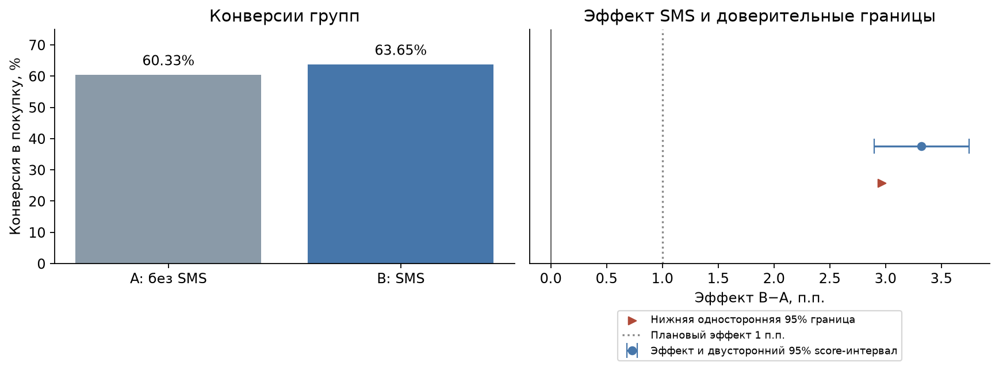
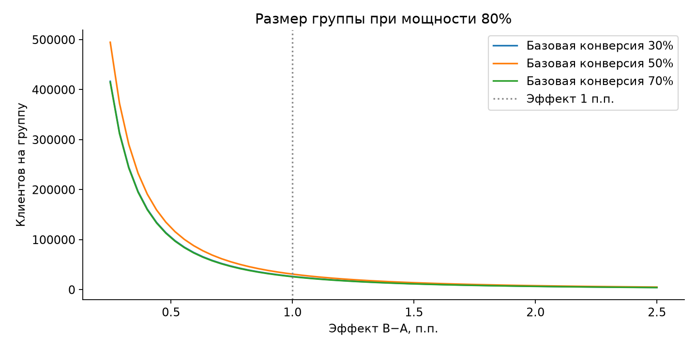
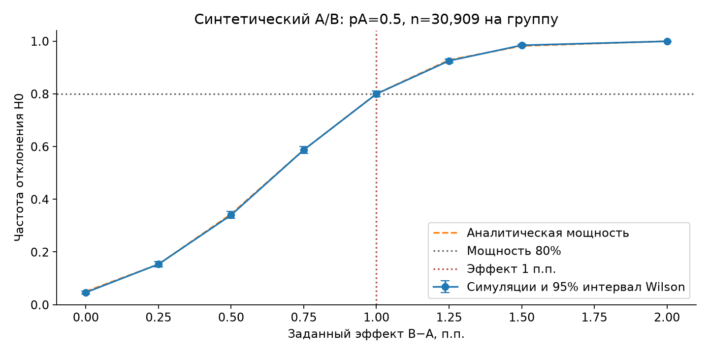
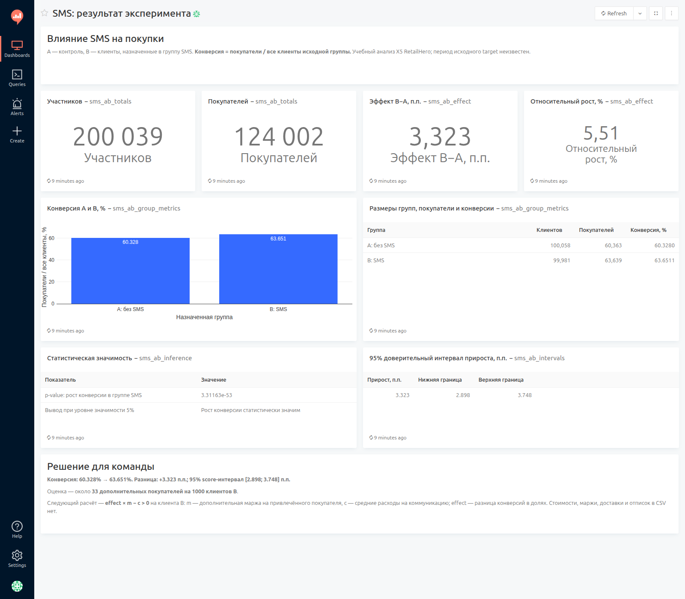

# Анализ A/B-теста SMS-рассылки

Сравниваю конверсию в покупку у клиентов, назначенных в группу SMS, и контрольной группы. Оцениваю прирост числа покупателей и условие окупаемости коммуникации.

Учебный анализ на открытых данных завершённого эксперимента [X5 RetailHero](https://ods.ai/competitions/x5-retailhero-uplift-modeling/data): 200 039 клиентов, назначенная группа и факт покупки. Период покупки в файле не указан.

## Результат

Проверил пропуски и повторы клиентов, сравнил конверсии односторонним z-тестом и рассчитал доверительный интервал разницы B−A. В анализ вошла вся выборка.

| Группа | Клиентов | Покупателей | Конверсия |
|---|---:|---:|---:|
| A: контроль | 100 058 | 60 363 | 60,328% |
| B: SMS | 99 981 | 63 639 | 63,651% |

Конверсия в группе SMS выше на **3,323 п.п.**, относительный рост — **5,51%**. Рост статистически значим при alpha=0.05: односторонний p-value — **3,31×10⁻⁵³**. Двусторонний 95% score-интервал разницы — **[2,898; 3,748] п.п.**

Наблюдаемая разница соответствует оценке **33 дополнительных покупателей на 1000 клиентов группы SMS**.

Следующий расчёт — покрывает ли дополнительная маржа расходы: `effect * m - c > 0` на одного клиента B. Здесь `effect` — разница конверсий в долях, `m` — дополнительная маржа на привлечённого покупателя, `c` — расходы на коммуникацию на клиента B. Стоимости, маржи, доставки и отписок в CSV нет.

Конверсии групп и доверительные границы эффекта:



## Выборка и мощность

Для базовой конверсии 50%, эффекта +1 п.п., alpha=0.05 и мощности 80% рассчитал **30 909 клиентов на группу**. При доступных размерах групп обнаружимый эффект для того же сценария — **0,556 п.п.** Параметры расчёта описаны в [дизайне эксперимента](experiment_design.md).



Проверил критерий на 5000 синтетических A/A и 5000 A/B для каждого эффекта. Доля ложных срабатываний в A/A — **4,68%**. При эффекте +1 п.п. эмпирическая мощность составила **79,94%**, аналитическая — **80,00%**.



## Анализ и дашборд

Основные расчёты и выводы — в [sms_ab_analysis.ipynb](sms_ab_analysis.ipynb). Локальный дашборд Redash показывает конверсии, прирост, значимость и решение для команды.



Открыть ноутбук в подготовленном окружении:

```bash
.venv/bin/python -m jupyterlab sms_ab_analysis.ipynb
```

Загрузка результатов в PostgreSQL и настройка Redash описаны в [инструкции запуска](redash_setup.md). CSV в `results/` нужны для этой загрузки.

Стек: Python, pandas, NumPy, SciPy, statsmodels, Matplotlib, PostgreSQL, Redash.
